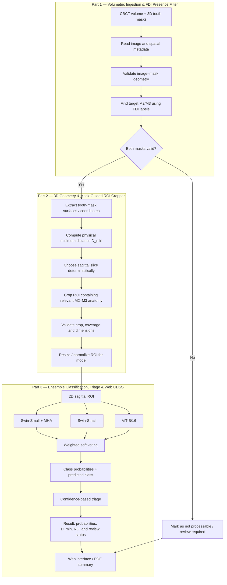

# AGENTS.md — CBCT M3–M2 Relationship Analysis CDSS

## 1. Project Goal & Academic Scope

Build a research prototype of a web-based Clinical Decision Support System (CDSS) that helps review the spatial-pathological relationship between a third molar (M3) and its adjacent second molar (M2) on Cone-Beam Computed Tomography (CBCT).

* **Project Title:** Rancang Bangun Sistem Pendukung Keputusan Klinis Klasifikasi Relasi Gigi Molar Ketiga dan Kedua (M3-M2) pada Citra CBCT Menggunakan Mask-Guided Vision Transformer Ensemble dan Clinical Triage Gate
* **Author / Candidate:** M. Reza (NRP: 3126640060)
* **Advisor:** Nana Ramadijanti, S.Kom., M.Kom. (NIP: 197111091998022001)
* **Institution:** Program Studi Sarjana Terapan Teknik Informatika, Departemen Teknik Informatika dan Komputer, Politeknik Elektronika Negeri Surabaya (PENS), 2025.
* **Base Research Paper:**
  > Karslıoğlu, H., Bektaş, J., Sal, L., Durukan, M., & Ozemre, M. O. (2026). *Comparative Evaluation of Hybrid Attention-CNN and Vision Transformer Models for Multi-Class Classification of Third–Second Molar Relationships on CBCT*. **Diagnostics**, 16(13), 2123. https://doi.org/10.3390/diagnostics16132123 (Full summary in [`docs/base_paper_summary.md`](docs/base_paper_summary.md)).

The core research gap is **the integration and separate evaluation of 3D segmentation-mask-guided selection of a relevant sagittal slice and 2D Region of Interest (ROI) before image-level classification**. The project is not claiming that Vision Transformers, weighted ensembles, or confidence-based triage are new by themselves.

The system is a research aid. It must not present model output as a definitive clinical diagnosis or replace a dentist/radiologist.

---

## 2. Intended Pipeline



---

## 3. Inputs and Output

### Required Inputs
* **CBCT Volume:** 3D CBCT volume in a supported format (e.g., DICOM series or NIfTI `.nii.gz`), subject to implementation support.
* **3D Segmentation Mask:** Integer label mask aligned with the CBCT volume containing target tooth labels according to the Fédération Dentaire Internationale (FDI) schema:
  * Maxillary Right: Tooth `17` (M2) & Tooth `18` (M3)
  * Maxillary Left: Tooth `27` (M2) & Tooth `28` (M3)
  * Mandibular Left: Tooth `37` (M2) & Tooth `38` (M3)
  * Mandibular Right: Tooth `47` (M2) & Tooth `48` (M3)
  * Ancillary Structures: `Maxillary_Sinus` (maxillary) / `Mandibular_Canal` (mandibular)
* **Spatial Metadata:** Sufficient metadata to map voxel indices to physical coordinates: spacing $(s_x, s_y, s_z)$, origin, and direction cosine matrix / orientation.
* **Traceable Clinical Relationship Label:** For each classification training/evaluation example, if available: `Class 0 (Contact)`, `Class 1 (Independent)`, or `Class 2 (Resorption / ERR)`.

### Outputs
* Data/mask validation status and logged diagnostic reason for any failure.
* Selected sagittal slice index and auto-extracted 2D ROI ($224 \times 224$).
* Physical minimum surface distance ($D_{\min}$) as supporting geometric information only.
* Ancillary anatomical geometric metrics: Winter's angulation, Pell & Gregory depth, and Sinus proximity.
* Predicted class and per-class probability distribution.
* Triage status: `Prediction Meets Threshold` ($\text{Conf} \ge 0.70$) or `Review Required` ($\text{Conf} < 0.70$, missing masks, or cropper failure).
* Technical evaluation metrics and an interactive web (Streamlit) / PDF clinical summary.

---

## 4. Critical Data Constraint — Verify Before Training

> [!CAUTION]
> **Do not assume that ToothFairy2 segmentation labels include the clinical relationship classes `Independent`, `Contact`, and `Resorption`.**
> Tooth masks identify anatomy; they do not by themselves establish clinical contact or root resorption.

Before implementing model training, perform a dataset audit and record:
1. Which CBCT volumes are available and their file formats.
2. Whether M2 and M3 masks are present for each target FDI pair.
3. Whether image and mask spatial metadata align (origin, spacing, orientation).
4. Whether a trustworthy clinical relationship label exists for each case, its source, and its annotation protocol (e.g., adjudicated ground-truth via joint review with an Oral and Maxillofacial Radiologist / drg. Sp.RKG).
5. Whether patient/volume identifiers allow leakage-safe splitting.

If clinical labels are unavailable, do not fabricate them from $D_{\min}$, and do not train/evaluate a three-class classifier using pseudo-labels as if they were clinical ground truth. Report the blocker and propose a defensible labeling/data-acquisition plan before continuing.

---

## 5. Geometric Processing Rules

* **Physical Coordinate Conversion:** Convert voxel indices to physical millimeter coordinates using the image metadata. Do not calculate millimeter distances from raw voxel-index differences alone.
* **Surface-to-Surface Distance ($D_{\min}$):** Compute $D_{\min}$ between the boundary surfaces ($\partial \mathcal{M}_{\text{M2}}$, $\partial \mathcal{M}_{\text{M3}}$) using a $k$-d tree (KD-Tree), not indiscriminately between all interior voxels:
  $$D_{\min}(\mathcal{M}_{\text{M2}}, \mathcal{M}_{\text{M3}}) = \min_{a \in \partial \mathcal{M}_{\text{M2}}, \, b \in \partial \mathcal{M}_{\text{M3}}} \|a - b\|_2$$
* **Non-Classifier Principle:** $D_{\min}$ is a geometric cue for locating a candidate region. It is **not** a standalone clinical classifier.
  * Do not label `Independent` merely because $D_{\min} > 0.5\text{ mm}$ unless a defensible source and validation protocol have been established.
  * Do not infer `Contact` or `Resorption` from a small distance alone.
  * Keep geometric measurements as metadata/features for display and analysis unless a separately justified experiment evaluates their use in classification.
* **Sagittal Plane Selection:** Select the sagittal plane using image orientation/direction metadata, not by assuming a fixed array axis.
* **Deterministic Tie-Breaking:** Define deterministic tie-breaking for multiple equally close points or candidate slices.
* **Deterministic Bounding Window:** Pusat crop ditetapkan pada titik tengah pasangan titik kontak terdekat $c^* = \frac{u^* + v^*}{2}$ yang difokuskan pada elevasi akar dan servikal.
* **Explicit Boundary Behavior:** Make crop coordinates, crop dimensions ($224 \times 224$), physical field of view, coordinate clamping, padding behavior, and failure reasons explicit and testable.
* **Coverage Verification:** Check that the ROI contains the intended M2/M3 anatomy. A crop with valid dimensions is not automatically anatomically valid.
* **Ancillary 3D Geometric Features (Supporting Evidence):**
  * *Winter's Angulation:* Principal longitudinal axis vectors via 3D Principal Component Analysis (PCA) on voxel clouds ($\vec{v}_{\text{M2}}, \vec{v}_{\text{M3}}$) to classify angulation (Vertical, Mesioangular, Distoangular, Horizontal).
  * *Pell & Gregory Depth:* Coronal elevation of M3 relative to occlusal plane and cervical line of M2 (Class A, B, C).
  * *Maxillary Sinus Floor (MSF) Proximity:* Euclidean distance from M3 root apices to sinus floor.

---

## 6. Classification and Triage

The planned image-level classifier is a weighted soft-voting ensemble of:
1. `Swin-Small + MHA(head)` (Swin-Small backbone with an extra Multi-Head Self-Attention block $d_{\text{model}} = 768$, heads $= 8$, and LayerNorm before the linear head).
2. `Swin-Small` (Standard `swin_small_patch4_window7_224`).
3. `ViT-Base/16` (Standard `vit_base_patch16_224`).

### Initial Ensemble Configuration
The proposed initial weights are `1.0`, `0.9`, and `0.8` respectively, normalized by their sum (`2.7`):
$$P_{\text{final}} = \frac{1.0 \cdot p_{\text{Swin-S+MHA}} + 0.9 \cdot p_{\text{Swin-S}} + 0.8 \cdot p_{\text{ViT-B/16}}}{2.7}$$
$$\hat{y} = \arg\max_{c \in \{0, 1, 2\}} P_{\text{final}}(c)$$

> [!NOTE]
> Treat these weights as **initial configuration values** adopted from baseline literature (Karslıoğlu et al., 2026), not proven optimal weights. Make them configurable and document how final values are selected using training/validation data only.

### Confidence-Based Clinical Triage Gate
Compute prediction confidence: $\text{Conf} = \max_{c \in \{0, 1, 2\}} P_{\text{final}}(c)$.

The initial operational threshold is $\tau = 0.70$:
* If $\text{Conf} \ge 0.70$ and upstream processing succeeded: `Prediction Meets Threshold`
* If $\text{Conf} < 0.70$: `Review Required`
* If volume validation fails, masks are empty/missing, or ROI extraction fails: Tag as `Review Required` (Status Gagal / Perlu Pemeriksaan) regardless of confidence.

This is an operational confidence threshold, not proof of clinical correctness. Evaluate threshold trade-offs ($\tau \in \{0.50, 0.70, 0.90\}$) on validation data (measuring coverage, selective risk, and error rate), then freeze the rule before final test evaluation. If feasible, evaluate model calibration (ECE) as well as accuracy.

---

## 7. Research Evaluation Plan

Evaluate the ROI module separately from classification.

### ROI / Cropper Metrics
* **Extraction Success Rate (ESR):**
  $$\text{ESR} = \frac{N_{\text{successful}}}{N_{\text{valid}}} \times 100\%$$
* **Dual-Tooth Anatomical Coverage (DTAC):**
  $$\text{DTAC} = \frac{N_{\text{ROI Meeting Coverage Criteria}}}{N_{\text{ROI Evaluated}}} \times 100\%$$
  Percentage of evaluated ROIs meeting a pre-defined coverage criterion for relevant M2 and M3 anatomy based on mask examination.
* **Algorithmic Reproducibility (AR):**
  $$\text{AR} = \frac{N_{\text{identicalOutputs}}}{N_{\text{repeatedCases}}} \times 100\%$$
  Percentage of repeated runs with identical selected slice and crop coordinates under identical inputs/configuration.
* **Computational Latency (CL):**
  Time from validated volume/mask availability to a model-ready ROI. Report measurement setup, median, and 95th percentile (P95) in milliseconds.

### Classification Metrics
Report class-sensitive metrics: Macro-F1, per-class Precision and Recall, Confusion Matrix, and Accuracy. Macro-AUC is included where class counts and probabilistic scores support it.
* **Composite Ranking Score:**
  $$\text{Composite Score} = 0.444 \cdot \text{Macro-F1} + 0.333 \cdot \text{Macro-AUC} + 0.222 \cdot \text{Accuracy}$$

### Baseline ROI Comparison & Ablation
Compare:
1. Each individual model (Swin-S+MHA, Swin-S, ViT-B/16),
2. The weighted ensemble,
3. Baseline non-mask-guided ROI extraction vs. Mask-Guided ROI extraction.

For an ablation that tests the core research gap, keep the classifier, data split, preprocessing, and evaluation protocol fixed while comparing mask-guided ROI against the baseline ROI strategy. State clearly what changes between conditions.

### Leakage Prevention
Split strictly by patient or CBCT volume, never by extracted slice/ROI. All examples from the same patient/volume must remain in one partition. Use validation data for model/weight/threshold selection and reserve the test set for final evaluation.

---

## 8. Codebase Layout & Implementation Architecture

The experiment repository is organized as follows:

```text
projects/m3-m2-experiments/
├── data -> Junction to ../../data          # Shared CBCT & ToothFairy2 datasets (0 MB duplication)
├── weights -> Junction to ../../weights    # Exported PyTorch checkpoint files (.pth)
├── src/
│   ├── config.py             # Global constants, seed (42), dynamic data path resolution
│   ├── data/
│   │   ├── loader.py         # SimpleITK / Nibabel I/O and spatial metadata validation
│   │   ├── fdi_filter.py     # Presence filter for FDI pairs (17-18, 27-28, 37-38, 47-48)
│   │   ├── preprocessor.py   # KD-Tree surface extraction, D_min, sagittal ROI cropper
│   │   └── eval_cropper.py   # Cropper evaluation benchmarks (ESR, DTAC, AR, Latency)
│   ├── geometry/
│   │   ├── spatial_dist.py   # Surface Euclidean distance & maxillary sinus proximity
│   │   └── impaction_pca.py  # 3D PCA axis angle (Winter) & depth (Pell-Gregory)
│   ├── models/
│   │   ├── vit_backbones.py  # Swin-Small, ViT-Base/16, Swin-Small + MHA(head)
│   │   ├── stage2_classifier.py # Stage-2 Resorption classifier
│   │   ├── hierarchical_pipeline.py # 2-stage hierarchical classifier
│   │   └── ensemble.py       # Weighted soft-voting (1.0, 0.9, 0.8) + Triage logic
│   ├── explainability/
│   │   └── saliency.py       # Grad-CAM attention overlays on transformer feature maps
│   ├── report/
│   │   └── pdf_export.py     # Standardized dental radiology PDF report generator
│   └── training/
│       ├── train.py          # Unified PyTorch training loop
│       └── evaluate.py       # Metrics: Accuracy, Macro-F1, Macro-AUC, Composite Score
├── scripts/                  # Data audit, CEJ annotation, training, and evaluation scripts
├── notebooks/                # Jupyter notebook spatial analysis
├── tests/                    # Pytest test suite (geometry, I/O, cropping, triage)
├── reports/                  # Generated benchmark evaluation reports & logs
├── pytest.ini                # Pytest configuration with pythonpath = .
└── requirements.txt          # Python dependencies
```

---

## 9. Agent Working Rules

1. **Inspect before editing.** Read the repository tree, README, dependency files, existing code, tests, and configuration first.
2. **Work incrementally.** Implement one module at a time; avoid large rewrites or speculative abstractions.
3. **Preserve working conventions.** Follow the repository's current style and dependency versions unless there is a clear reason to change them.
4. **No fabricated results.** Never invent dataset sizes, labels, metric values, citations, clinical criteria, or successful test runs.
5. **Separate facts from assumptions.** Put unresolved assumptions in a short `docs/OPEN_QUESTIONS.md` or report them before relying on them.
6. **Write tests for geometry.** Include tests for spacing, non-identity direction matrices, image/mask mismatch, empty masks, boundary crops, deterministic ties, and physical-distance correctness.
7. **Make outputs reproducible.** Record config, random seeds (`42`), split identifiers, model checkpoints, package versions, and metric outputs.
8. **Protect data.** Do not commit CBCT scans, identifiable clinical data, credentials, or large model weights. Use a data manifest and document secure local paths.
9. **Keep clinical claims cautious.** Display model results as research outputs requiring professional review. Avoid wording such as “diagnosed” or “confirmed” unless clinically validated and authorized.
10. **Explain changes.** For each task, report files changed, implementation choices, commands run, test results, and remaining limitations.
11. **Do not silently change the research question.** If a decision changes the 3D-to-2D ROI contribution, labeling strategy, class definitions, or evaluation protocol, flag it before implementation.
12. **Do not assume the prior paper's ensemble weights or 0.70 threshold are novel.** They are baselines/reference choices that require evaluation in this project.

---

## 10. Recommended First Tasks

### Task 1 — Repository and environment audit
* Inspect the current project and report its framework, entry points, dependencies, tests, and current implementation state.
* Do not modify the architecture yet.
* Identify existing codebase artifacts (`src/geometry/spatial_dist.py`, ToothFairy2 archives, notebooks).

### Task 2 — Dataset feasibility audit
Create a script/notebook or manifest report that inventories:
* Volume and mask files available in `data/`,
* File formats and dimensions,
* Voxel spacing, origin, direction matrix,
* Target FDI label availability (teeth 17, 18, 27, 28, 37, 38, 47, 48) and non-empty voxel counts,
* Image-mask spatial consistency,
* Presence/absence and provenance of clinical class labels (`Independent`, `Contact`, `Resorption`).
* **Note:** This task is a blocker for supervised classification if valid clinical labels are absent.

### Task 3 — Geometry and ROI prototype
Before deep-learning training, implement and test:
* Image/mask spatial validation,
* Target FDI pair lookup and presence verification,
* Physical-space surface $D_{\min}$ via KD-Tree,
* Deterministic sagittal slice selection,
* Fixed-size ($224 \times 224$) ROI extraction and boundary clamping/padding,
* Quantitative ESR / DTAC / AR / Latency evaluation.
* Use synthetic arrays or non-sensitive test fixtures for unit tests; do not present synthetic test data as clinical evaluation.

### Task 4 — Baseline ROI comparison
Define and implement a reproducible baseline (e.g., center-of-mass crop or a non-mask-guided bounding box) before claiming that mask-guided ROI improves results. Keep other experimental variables fixed.

### Task 5 — Classifier and triage
Proceed only when a traceable clinical-label dataset and leakage-safe split are available. Implement individual models first (`Swin-S`, `ViT-B/16`, `Swin-S+MHA`), then ensemble, then triage gate. Save validation-selected configurations and final test results separately.

### Task 6 — Web CDSS & PDF Report
Integrate the tested pipeline into the Streamlit UI. Display the selected slice, ROI, prediction probabilities, $D_{\min}$ and geometric metrics as supporting geometry, processing/triage status (`Prediction Meets Threshold` vs. `Review Required`), and clear review disclaimers. Generate structured dental radiology PDF summaries only after the underlying result schema is stable.

---

## 11. Definition of Done

A task is done only when:
* Its behavior is documented,
* Relevant tests pass,
* Failure cases are handled explicitly with logged diagnostic reasons,
* Outputs are reproducible,
* No unsupported clinical assumptions are introduced,
* And the agent reports what was actually tested versus what remains unverified.

> [!IMPORTANT]
> The research contribution should ultimately be demonstrated by an experiment that isolates the effect of **mask-guided 3D-to-2D ROI selection**—not merely by successfully building a UI or reproducing a Transformer ensemble.
