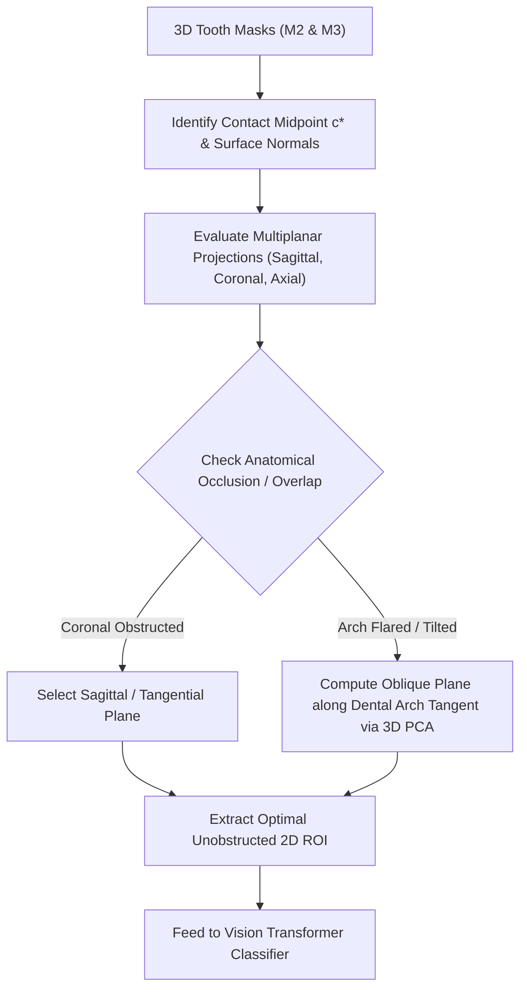

# NOTE.md — Research & Technical Exploration Notes

**Project:** CBCT M3–M2 Relationship Analysis Clinical Decision Support System (CDSS)  
**Authors:** M. Reza & AI Pair Programming Agent  
**Date:** 2026-10-29  

---

## 1. Multiplanar Analysis & Adaptive ROI Selection

### 1.1 Anatomical Background & The Problem of Occlusion
In dentomaxillofacial radiology and Cone-Beam Computed Tomography (CBCT):
* **Dental Arch Curvature:** The human dental arch is parabolic. While teeth near the midline (incisors/canines) are aligned along the coronal plane, molars (M1, M2, M3) sit in the posterior segment where the arch curves laterally and posteriorly.
* **Coronal View Occlusion (*Blocked from Infront*):**
  - In a standard coronal plane ($Y = \text{const}$), viewing posterior molars from the front often results in **superimposition** (e.g., M2 occluding M3, or the crown of M2 obscuring the cervical/root contact zone of M3).
  - Similarly, the ascending mandibular ramus or zygomatic process can cast anatomical shadows or obstruct clear visibility in non-ideal planes.
* **Standard Sagittal Plane Limitations:**
  - A fixed sagittal cut ($X = \text{const}$, parallel to skull midline) may intersect the flared molar arch obliquely rather than strictly perpendicular to the contact interface.

---

## 2. Core Idea: Multiplanar Information as an "Adaptive ROI Decider"

Instead of treating multiplanar views merely as passive displays or blindly stacking orthogonal slices, **use 3D segmentation masks and multiplanar geometry to dynamically decide and select the optimal viewing plane.**

---

## 3. Potential Technical Implementations

### Approach A: Occlusion-Aware Viewing Angle Selector (The "Decider")
1. **Ray-Casting / Line-of-Sight Check:**
   - Using the 3D masks of adjacent teeth (e.g., M1, M2, M3, and cortical bone), cast rays through the candidate plane.
   - Calculate the **Occlusion Index**: what percentage of the M2–M3 contact interface is shadowed by anterior or lateral structures.
2. **Plane Decision Rule:**
   - If the sagittal plane has lower occlusion than the coronal plane, designate the sagittal plane as primary.
   - If severe tilting exists (e.g., horizontally impacted mandibular M3), switch to an oblique reconstructed plane.

### Approach B: PCA-Based Oblique / Tangential Slicing (Curved Planar Reformation)
1. **Principal Component Analysis (PCA):**
   - Run PCA on the coordinates of M2 and M3 to find the local longitudinal and buccolingual axes.
2. **Oblique Plane Rotation:**
   - Rather than slicing along fixed Cartesian $X$, rotate the cutting plane by angle $\theta$ such that the plane is **strictly perpendicular to the dental arch curve at the contact zone**.
   - This ensures the interdental space is cut exactly on-edge, maximizing visibility of periodontal ligament (PDL) space and cervical resorption defects.

### Approach C: Multiplanar 3-Channel Fusion (RGB Orthogonal Stacking)
* If occlusion in coronal/axial views is manageable:
  - Channel 0 (Red): Sagittal slice at $c^*$
  - Channel 1 (Green): Coronal slice at $c^*$
  - Channel 2 (Blue): Axial slice at $c^*$
* **Benefit:** The 2D Vision Transformer receives 3 orthogonal spatial perspectives simultaneously within a single standard $224 \times 224 \times 3$ tensor, bridging 2D efficiency with 3D multiplanar context.

---

## 4. Academic Defense & Thesis Strategy

* **Current Proposal Scope:**
  - Establishes the foundational bridge: 3D Mask $\rightarrow$ $D_{\min}$ (KD-Tree) $\rightarrow$ Deterministic Sagittal Slice $\rightarrow$ 2D ROI $\rightarrow$ ViT Ensemble $\rightarrow$ Triage.
  - Multiplanar Reconstruction (MPR) currently operates as the interactive clinician viewer in the Streamlit CDSS and as the reference standard during *joint review / ground truth adjudication*.
* **Discussion / Future Work Hook:**
  - This "Adaptive Multiplanar Decider" concept serves as a strong answer to thesis examiners asking:
    > *"What happens if the tooth is severely angled or blocked on the standard sagittal plane?"*
  - Answer: The architecture is modular—the deterministic slice selector can be extended from orthogonal Cartesian slicing to an **adaptive occlusion-aware / oblique plane selector** without changing the downstream classifier.
