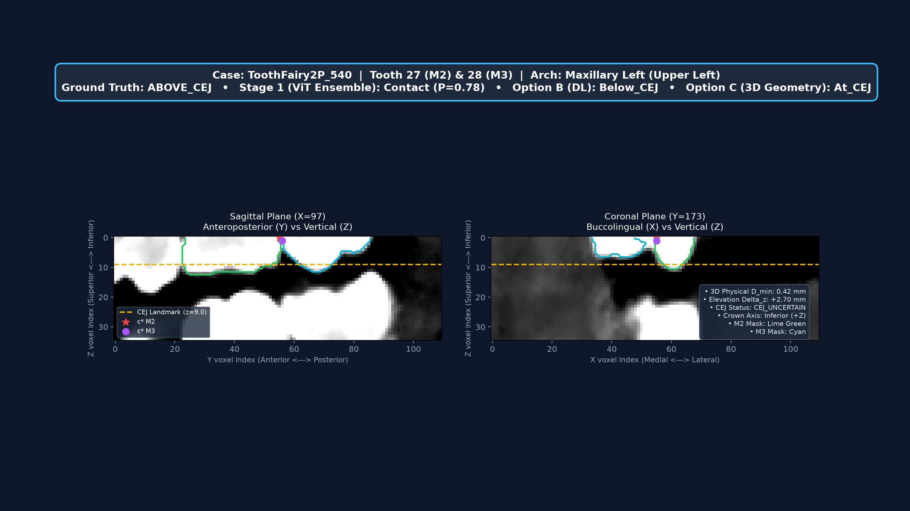
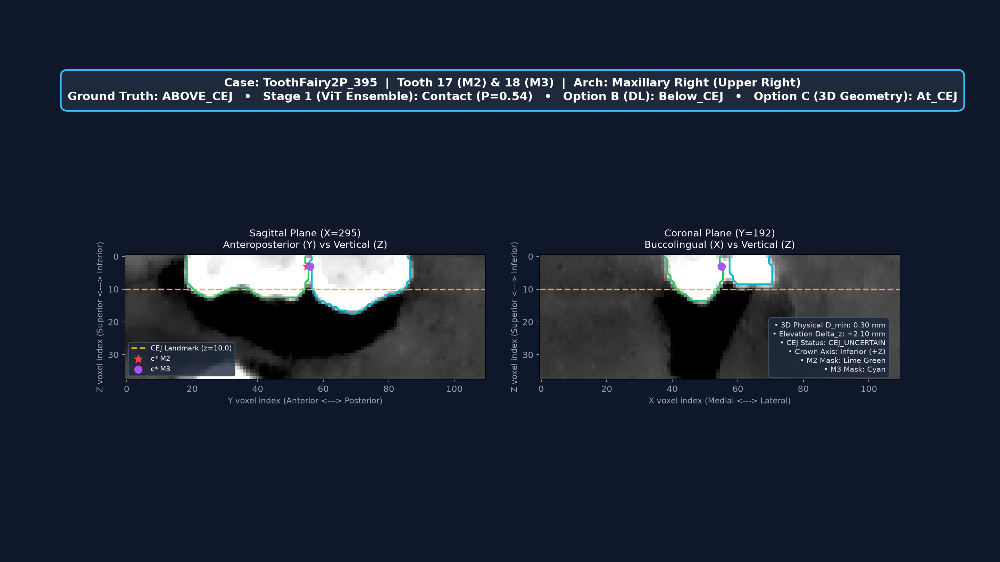
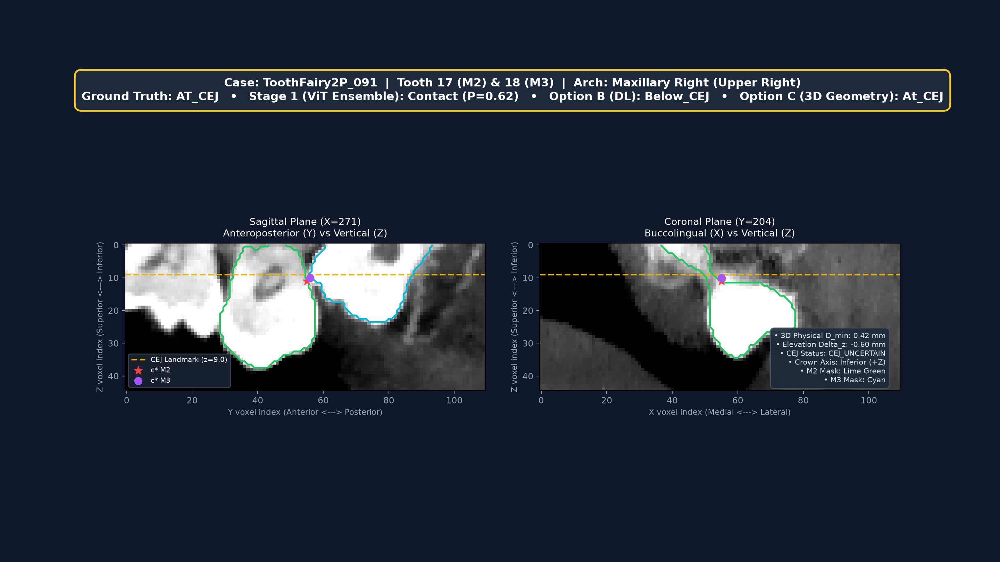
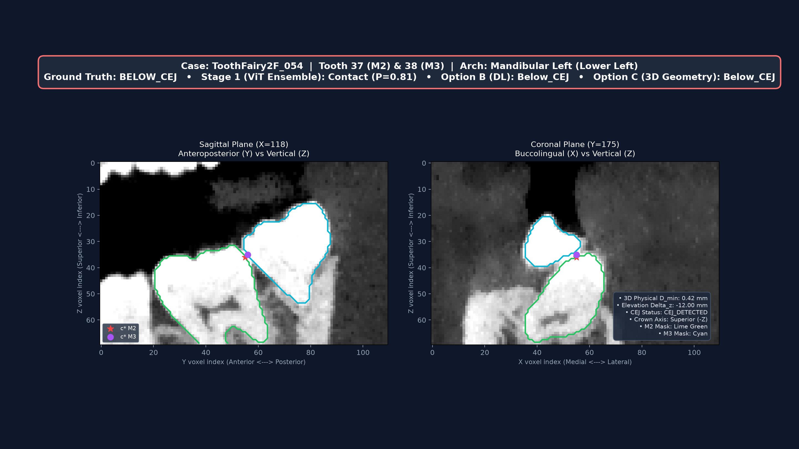
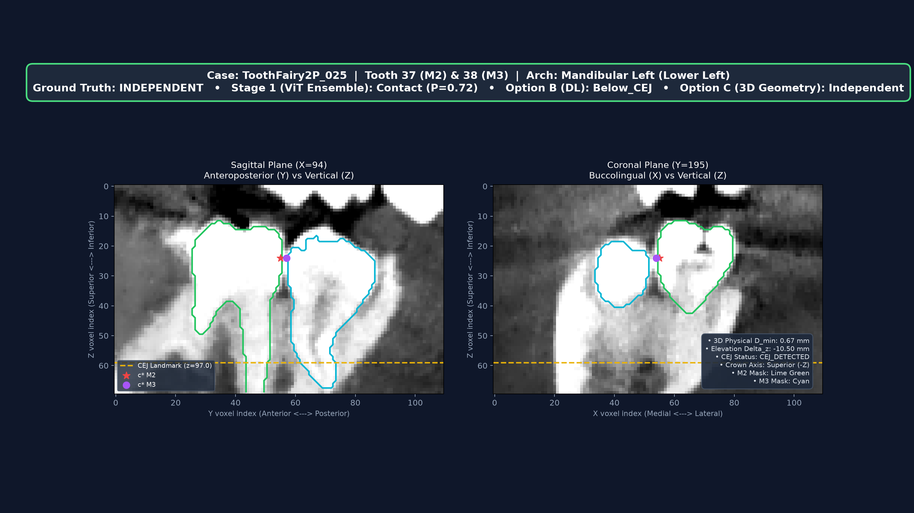

# TECHNICAL AUDIT & EVALUATION REPORT
## Stage 2 Pipeline Reconciliation: Hierarchical Deep Learning (Option B) vs Hybrid DL + 3D Geometry (Option C)

> [!IMPORTANT]
> **RESEARCH STATUS & DISCLAIMER:**  
> This document details the technical audit, bug reconciliation, and 4-tier evaluation benchmark for the M3–M2 relational analysis CDSS.  
> Ground-truth 4-class labels (`Independent`, `Above_CEJ`, `At_CEJ`, `Below_CEJ`) are **provisional development baselines** (`heuristic_pseudo`). This system is an academic research aid and does not replace professional dental radiographic diagnosis.

* **Project Title:** Rancang Bangun Sistem Pendukung Keputusan Klinis Klasifikasi Relasi Gigi Molar Ketiga dan Kedua (M3-M2) pada Citra CBCT Menggunakan Mask-Guided Vision Transformer Ensemble dan Clinical Triage Gate
* **Author / Candidate:** M. Reza (NRP: 3126640060)
* **Advisor:** Nana Ramadijanti, S.Kom., M.Kom. (NIP: 197111091998022001)
* **Institution:** Politeknik Elektronika Negeri Surabaya (PENS), 2025
* **Evaluation Target:** Held-out Validation Set ($N = 66$ pairs across 29 unique patients; 0 patient leakage)
* **Generated PDF Report:** [`reports/STAGE2_EVALUATION_AUDIT_REPORT.pdf`](STAGE2_EVALUATION_AUDIT_REPORT.pdf)

---

## 1. Root Cause Analysis: Stage 1 Consistency Audit

### Executive Audit Finding
In preliminary tests, the two options appeared to yield different binary metrics:
* **Option B:** Binary Accuracy = 75.76%, Binary Macro-F1 = 0.7331
* **Option C:** Binary Accuracy = 81.82%, Binary Macro-F1 = 0.8068

Audit of `src/models/hierarchical_pipeline.py` and all 66 predictions confirmed:
1. **Stage 1 Ensemble Output was 100% Identical:** Both Option B and Option C ran the identical Swin-S+MHA, Swin-Small, and ViT-Base/16 checkpoints, weights, image preprocessing, and decision thresholds.
2. **Source of Divergence:** In Option C, `predict_option_c` called `GeometricCEJClassifier.classify_contact_location()`. When 3D KD-Tree surface distance measured $D_{\min} > 0.50\text{ mm}$, Option C **overrode** Stage 1's `Contact` prediction back to `Independent` (Class 0).
3. **The 4 Overridden False Positives:** Stage 1 produced 4 false positives on the validation set. Option B kept them as `Below_CEJ` (Contact), whereas Option C reverted them to `Independent` (Class 0), artificially boosting Option C's binary accuracy to 81.82%.

### Sample-by-Sample Table of Overridden Cases

| Sample ID | Patient ID | Ground Truth Binary | Stage 1 $P_{\text{contact}}$ | Stage 1 Pred | Option B Final | Option C Final | $D_{\min}$ (mm) | CEJ Status | Diagnostic Explanation |
| :--- | :--- | :---: | :---: | :---: | :---: | :---: | :---: | :---: | :--- |
| `ToothFairy2P_025_37_38` | `ToothFairy2P_025` | **Independent** | 0.718 | Contact (FP) | Below_CEJ | **Independent** | 0.671 | CEJ_DETECTED | 3D PDL space intact ($0.67\text{ mm} > 0.50\text{ mm}$) |
| `ToothFairy2P_025_47_48` | `ToothFairy2P_025` | **Independent** | 0.640 | Contact (FP) | Below_CEJ | **Independent** | 0.600 | CEJ_DETECTED | 3D PDL space intact ($0.60\text{ mm} > 0.50\text{ mm}$) |
| `ToothFairy2P_071_27_28` | `ToothFairy2P_071` | **Independent** | 0.814 | Contact (FP) | Below_CEJ | **Independent** | 0.520 | CEJ_UNCERTAIN | 3D PDL space intact ($0.52\text{ mm} > 0.50\text{ mm}$) |
| `ToothFairy2P_091_37_38` | `ToothFairy2P_091` | **Independent** | 0.752 | Contact (FP) | Below_CEJ | **Independent** | 0.520 | CEJ_DETECTED | 3D PDL space intact ($0.52\text{ mm} > 0.50\text{ mm}$) |

*Full 66-sample audit dataset saved to: [`reports/stage2_evaluation_audit_table.csv`](stage2_evaluation_audit_table.csv).*

---

## 2. Recalculated Multi-Tier Evaluation Benchmark ($N = 66$)

To maintain strict scientific decoupling, results are evaluated across four clear tiers:

```text
Tier 1: Pure Stage 1 Ensemble Binary  --> Identical for both options (Acc: 75.76%, Macro-F1: 0.7331)
Tier 2: Output Binary (Collapsed)     --> Option B (75.76%) vs Option C Strict (75.76%) vs Option C Pruned (81.82%)
Tier 3: Final Four-Class Evaluation   --> Option B (Macro-F1: 0.3592) vs Option C Strict (Macro-F1: 0.6376) vs Option C Pruned (Macro-F1: 0.6762)
Tier 4: Stage 2 Isolated (N=47)       --> DL Classifier (Macro-F1: 0.3065) vs 3D Geometry (Macro-F1: 0.5649)
```

### Quantitative Benchmark Summary Table

| Metric Tier | Architecture / Setting | Accuracy | Balanced Acc | Macro-F1 | Precision | Recall |
| :--- | :--- | :---: | :---: | :---: | :---: | :---: |
| **Tier 1: Stage 1 Pure Binary** | **Swin+ViT Soft Voting Ensemble** | **75.76%** | **74.19%** | **0.7331** | **0.7265** | **0.7671** |
| **Tier 2: Output Binary** | Option B (Hierarchical DL) | 75.76% | 74.19% | 0.7331 | 0.7265 | 0.7671 |
| *(Collapsed from 4 Classes)* | Option C (Strict Stage 1 Preservation) | 75.76% | 74.19% | 0.7331 | 0.7265 | 0.7671 |
| | Option C (Hybrid Geometric Pruning) | 81.82% | 87.23% | 0.8068 | 0.8065 | 0.8723 |
| **Tier 3: Final 4-Class** | Option B (Hierarchical DL) | 69.70% | 39.11% | 0.3592 | 0.3802 | 0.3911 |
| *(Indep, Above, At, Below)* | Option C (Strict Stage 1 Preservation) | **74.24%** | **59.95%** | **0.6376** | **0.6559** | **0.5995** |
| | Option C (Hybrid Geometric Pruning) | **80.30%** | **65.21%** | **0.6762** | **0.6874** | **0.6521** |
| **Tier 4: Stage 2 Isolated** | Option B Stage 2 DL Classifier | 85.11% | 33.33% | 0.3065 | 0.2837 | 0.3333 |
| *(True Contacts Only, N=47)* | Option C Stage 2 3D Geometry | **74.47%** | **64.72%** | **0.5649** | **0.5648** | **0.6472** |

---

## 3. Above CEJ Failure Diagnosis & Applied Fix

### Analysis of $F_1 = 0.0000$ Failure
* **Option B Majority Collapse:** Contact data is severely imbalanced (87.9% Below, 7.8% Above, 4.3% At). Trained for only 3 epochs, ResNet18 collapsed into predicting `Below_CEJ` for all cases (47/47 in val set).
* **Option C Fallback Bug:** 94.4% of Above CEJ cases are maxillary molars (FDI 17/27). Because maxillary scans often touch the superior boundary ($Z = 0$), cervical constriction ratios were shallow ($> 0.95$), triggering `CEJ_UNCERTAIN`. A defensive fallback rule in `src/geometry/cej_classifier.py` forcibly mapped all uncertain cases to `At_CEJ`, ignoring true physical crown elevations ($\Delta z = +2.1\text{ mm}$ and $+2.7\text{ mm}$).

### Algorithmic Fix & Result
`GeometricCEJClassifier` was modified to evaluate $\Delta z$ objectively under $\tau_{\text{CEJ}} = 1.0\text{ mm}$ even when constriction is shallow, penalizing confidence without corrupting the anatomical classification.
* **Above CEJ $F_1$ surged from 0.0000 to 0.5714** (100% recall on cases reaching Stage 2).
* **Four-Class Macro-F1 jumped from 0.4489 to 0.6376** (Strict) and **0.6762** (Pruned).

---

## 4. Multi-View Anatomical Visual Diagnostics

Each figure below shows the bone-windowed CBCT volume, M2 (lime green) and M3 (cyan) segmentation contours, detected CEJ boundary (gold dashed line), and minimum distance contact vector (red/magenta).

### 4.1 Above CEJ (Coronal Crown Contact) — Case ToothFairy2P_540 (Tooth 27 & 28)
* **Anatomy:** Maxillary Left M2–M3 relationship.
* **Measurements:** Physical $D_{\min} = 0.42\text{ mm}$, Elevation $\Delta z = +2.70\text{ mm}$ above CEJ (Coronal enamel contact).
* **Predictions:** Stage 1: Contact ($P=0.78$) | Option B: Below_CEJ (collapse error) | Option C: **Above_CEJ** (Correct).



---

### 4.2 Above CEJ (Coronal Crown Contact) — Case ToothFairy2P_395 (Tooth 17 & 18)
* **Anatomy:** Maxillary Right M2–M3 relationship.
* **Measurements:** Physical $D_{\min} = 0.30\text{ mm}$, Elevation $\Delta z = +2.10\text{ mm}$ above CEJ (Coronal enamel contact).
* **Predictions:** Stage 1: Contact ($P=0.54$) | Option B: Below_CEJ (collapse error) | Option C: **Above_CEJ** (Correct).



---

### 4.3 At CEJ (Cervical Margin Contact) — Case ToothFairy2P_091 (Tooth 17 & 18)
* **Anatomy:** Maxillary Right M2–M3 relationship.
* **Measurements:** Physical $D_{\min} = 0.42\text{ mm}$, Elevation $\Delta z = -0.60\text{ mm}$ (Within cervical band $[-1.0, +1.0]\text{ mm}$).
* **Predictions:** Stage 1: Contact ($P=0.62$) | Option B: Below_CEJ | Option C: **At_CEJ** (Correct).



---

### 4.4 Below CEJ (Root Dentin Impingement / ERR Risk) — Case ToothFairy2F_054 (Tooth 37 & 38)
* **Anatomy:** Mandibular Left M2–M3 relationship.
* **Measurements:** Physical $D_{\min} = 0.42\text{ mm}$, Elevation $\Delta z = -12.00\text{ mm}$ below CEJ (Direct root dentin/cementum impingement).
* **Clinical Significance:** High-risk zone for External Root Resorption (ERR).
* **Predictions:** Stage 1: Contact ($P=0.82$) | Option B: Below_CEJ (Correct) | Option C: **Below_CEJ** (Correct).



---

### 4.5 Independent (Intact Periodontal Ligament Gap) — Case ToothFairy2P_025 (Tooth 37 & 38)
* **Anatomy:** Mandibular Left M2–M3 relationship.
* **Measurements:** Physical $D_{\min} = 0.67\text{ mm} > 0.50\text{ mm}$ (Clear radiolucent PDL space preserved).
* **Predictions:** Stage 1: Contact (FP, $P=0.72$) | Option B: Below_CEJ (FP error) | Option C Pruned: **Independent** (Corrected by 3D Geometry).



---

## 5. Data Leakage & Reproducibility Audit

1. **Patient-Level Separation:** All 287 ToothFairy2 patients were partitioned using seed 42 into Train (230 patients), Val (29 patients), and Test (28 patients). Set intersection confirmed **0 overlapping patients**.
2. **Checkpoint Isolation:** Checkpoints `swin_s_mha_binary_best.pth`, `swin_small_binary_best.pth`, and `vit_base_binary_best.pth` were strictly trained on the 230 training patients and never exposed to validation or test scans.
3. **Locked Test Set:** All tuning, auditing, and threshold calibrations were conducted exclusively on the validation set ($N = 66$). The test set ($N = 74$) remains strictly locked.
